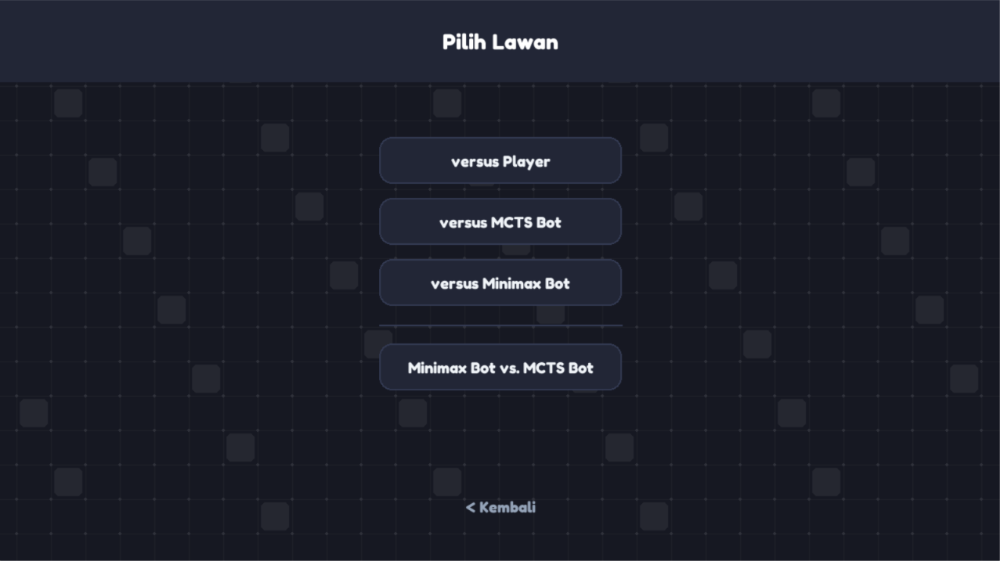
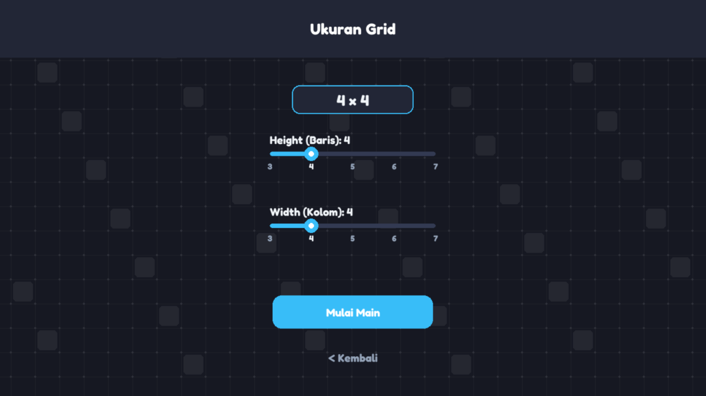
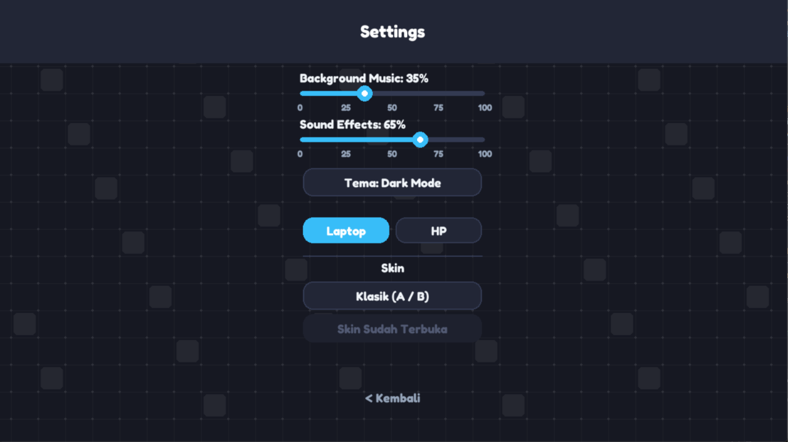
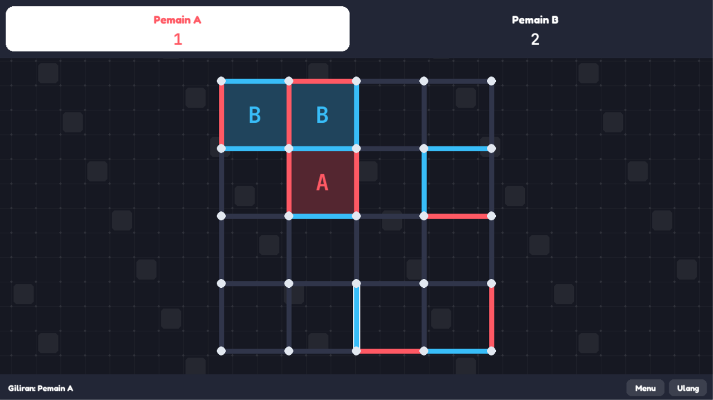

# GGS — Garis-Garis Square


GGS adalah permainan **Dots and Boxes** berbasis Python dan Pygame. Dua pemain bergantian menggambar garis pada sisi-sisi kotak. Pemain yang menggambar sisi keempat sebuah kotak mendapat poin dan giliran tambahan. Permainan berakhir setelah semua kotak terisi; pemain dengan skor tertinggi menang.

Permainan dapat dimainkan berdua pada satu komputer atau melawan AI. Proyek ini juga menyediakan mode AI melawan AI.

## Fitur

- Mode **Player vs Player**, **Player vs Minimax**, **Player vs MCTS**, dan **Minimax vs MCTS**.
- Ukuran papan dapat diatur dari 3×3 hingga 7×7 kotak; ukuran awal 4×4.
- AI Minimax dengan Alpha-Beta Pruning dan AI Monte Carlo Tree Search (MCTS).
- Pilihan tema Dark, Light, dan Naruto.
- Pilihan resolusi Laptop (1280×720, default) dan HP (440×800) di menu Settings.
- Pilihan skin kotak, efek suara, musik latar, serta pengaturan volume.
- Laporan hasil pertandingan dan statistik langkah AI disimpan di `logs/match_results.txt`.





## Teknologi

- Python 3
- Pygame untuk antarmuka dan audio
- NumPy untuk representasi papan permainan
- Dependensi Python lainnya tercantum di [`requirements.txt`](./requirements.txt)

## Instalasi dan Menjalankan

Jalankan perintah berikut dari folder proyek.

### Windows (PowerShell)

```powershell
py -m venv .venv
.\.venv\Scripts\Activate.ps1
python -m pip install -r requirements.txt
python main.py
```

Jika aktivasi virtual environment dibatasi oleh kebijakan PowerShell, jalankan perintah melalui interpreter virtual environment secara langsung:

```powershell
.\.venv\Scripts\python.exe -m pip install -r requirements.txt
.\.venv\Scripts\python.exe main.py
```

### Linux atau macOS

```bash
python3 -m venv .venv
source .venv/bin/activate
python -m pip install -r requirements.txt
python main.py
```

## Cara Bermain

1. Pilih **Play**, lalu pilih jenis lawan.
2. Pada mode melawan bot, pilih Minimax atau MCTS. Mode Player vs Player tidak menggunakan bot.
3. Atur jumlah baris dan kolom papan, lalu pilih **Mulai Main**.
4. Klik di dekat garis antara dua titik untuk menggambarnya.
5. Pemain yang melengkapi sebuah kotak mendapat satu poin dan bermain lagi. Jika tidak melengkapi kotak, giliran berpindah.
6. Setelah semua kotak terisi, skor tertinggi menentukan pemenang.



## Pengaturan dan Kontrol

### Settings

- **Tema:** tekan tombol tema untuk berganti siklus Dark → Light → Naruto.
- **Resolusi:** pilih **Laptop** atau **HP**. Laptop adalah pilihan awal; HP memakai ukuran 440×800.
- **Skin:** gunakan tombol skin untuk memilih tampilan kotak.
- **Audio:** atur volume musik latar dan efek suara dengan slider. Jika berkas audio tidak tersedia, permainan tetap dapat berjalan tanpa audio.

Mode HP mengubah ukuran tampilan game, bukan mengubah aplikasi menjadi aplikasi Android.

### Keyboard

| Tombol | Fungsi |
|---|---|
| `S` atau `F10` | Aktifkan/nonaktifkan mute |
| `F11` | Aktifkan/nonaktifkan fullscreen |
| `Esc` | Kembali atau keluar dari menu; saat bermain, meminta konfirmasi untuk kembali ke menu |
| `R` | Memulai ulang pertandingan (konfirmasi ditampilkan jika pertandingan sedang berjalan) |
| `M` | Meminta kembali ke menu (konfirmasi ditampilkan jika pertandingan sedang berjalan) |

Saat permainan selesai, klik papan atau tekan `R` untuk memulai pertandingan baru.

## Pengujian

Pasang pytest jika belum tersedia, kemudian jalankan seluruh pengujian dari folder proyek:

```bash
python -m pip install pytest
python -m pytest -q
```

## Struktur Proyek

```text
ETS-KKA/
├── assets/
│   ├── audio/          # Musik latar dan efek suara
│   ├── fonts/          # Font antarmuka
│   └── skins/          # Gambar skin kotak
├── config.py           # Konfigurasi papan, resolusi, warna, dan tema
├── main.py             # Entry point dan game loop
├── requirements.txt    # Dependensi Python
├── src/
│   ├── ai/
│   │   ├── minimax.py  # AI Minimax dengan Alpha-Beta Pruning
│   │   └── mcts.py     # AI Monte Carlo Tree Search
│   ├── audio.py        # Pemutaran audio dan pengaturan volume
│   ├── game_logic.py   # Aturan dan state permainan
│   ├── gui.py          # Menu, papan, dan antarmuka permainan
│   ├── logger.py       # Penulisan laporan pertandingan
│   └── store.py        # Pengelolaan skin dan status unlock
└── test/               # Pengujian konfigurasi, logika, GUI, dan AI
```

Data skin yang terbuka disimpan di `save_data.json`. Laporan pertandingan ditulis ke `logs/match_results.txt`.

## Dibuat Oleh

### Kelompok 1

| Nama | NRP |
|---|---|
| Aziz Alfarisi | 5025251130 |
| Komang Mahatma Langendria | 5025251151 |
| Fathan Nurtamam Amry | 5025251177 |
| I Dewa Gede Putra Susila | 5025251196 |
| Fadlie Akbar Indrianto | 5025251201 |
